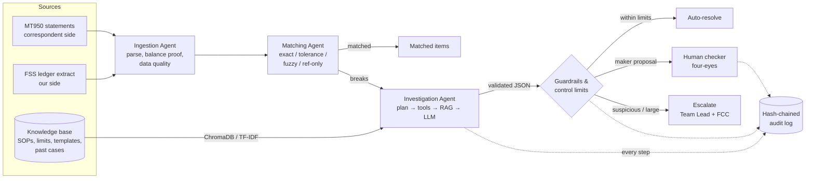

# Architecture

## Agent responsibilities

| Agent | Input | Tools | Output |
|---|---|---|---|
| Ingestion | MT950 files, ledger CSV, account static | MT950 parser, balance proof, data-quality checks | Clean ledger and statement tables; stop if proof fails |
| Matching | Ledger + statement tables | Rules engine (4 passes) | Matched pairs, paired breaks, one-sided breaks |
| Investigation | One break | Duplicate finder, reference lookup, limit check, amount compare, SOP search (RAG), LLM | Category, confidence, root cause, action, citations |
| Resolution | Investigation | Control limits, MT199 templates | AUTO_RESOLVE / MAKER_PROPOSAL / ESCALATE, draft query |
| Checker (human) | Approval queue | CLI or Streamlit dashboard | APPROVE / REJECT with comment |

## Why rules first, AI second
Matching is deterministic, cheap and fully explainable, so it handles most items. The LLM is used only for the
judgement step on the small number of breaks, where reading narratives, codes and SOPs adds value. Every LLM answer
is checked against a schema and the control policy before anything happens.

## Production view (planned)
- Databricks: Bronze (raw MT950 / camt.053, ledger), Silver (parsed, validated), Gold (matched, breaks, actions).
- Unity Catalog for access control and lineage; MLflow / LangSmith for prompt and model versions and evaluation.
- Agent runs as a scheduled Databricks Workflow after statement receipt; checker UI behind bank SSO.
